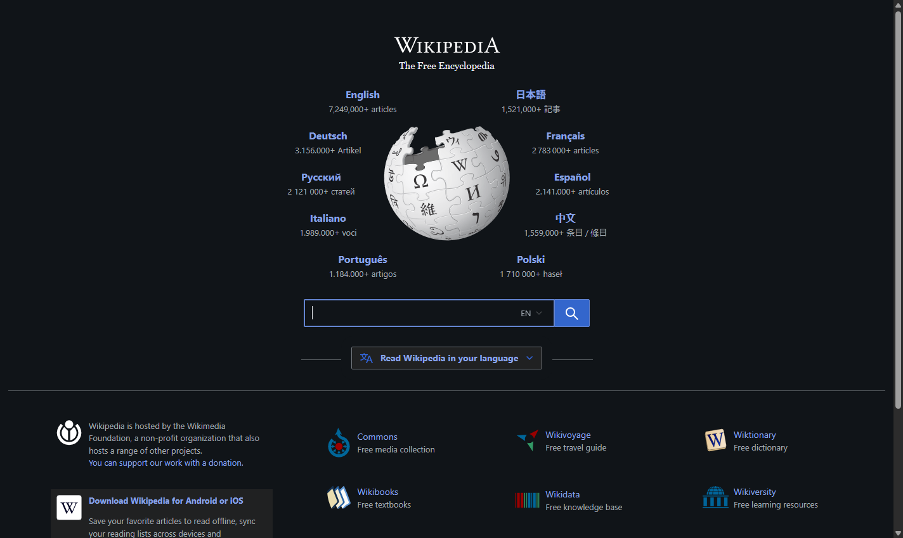
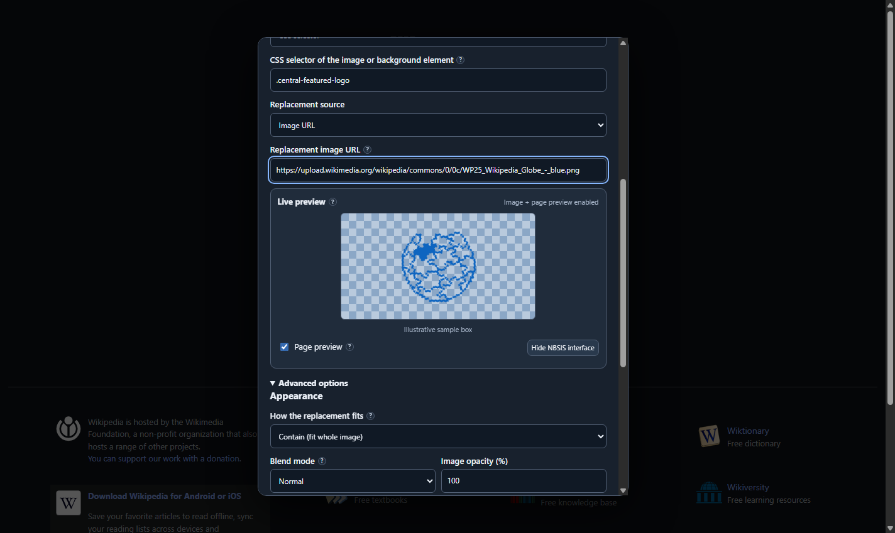
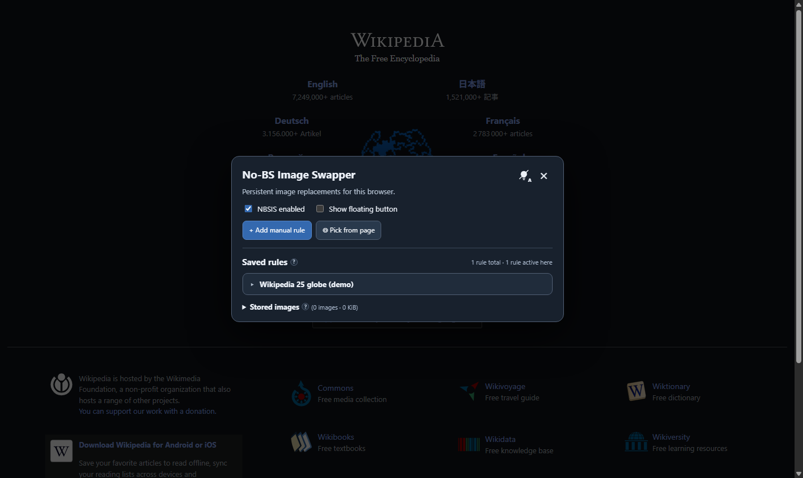
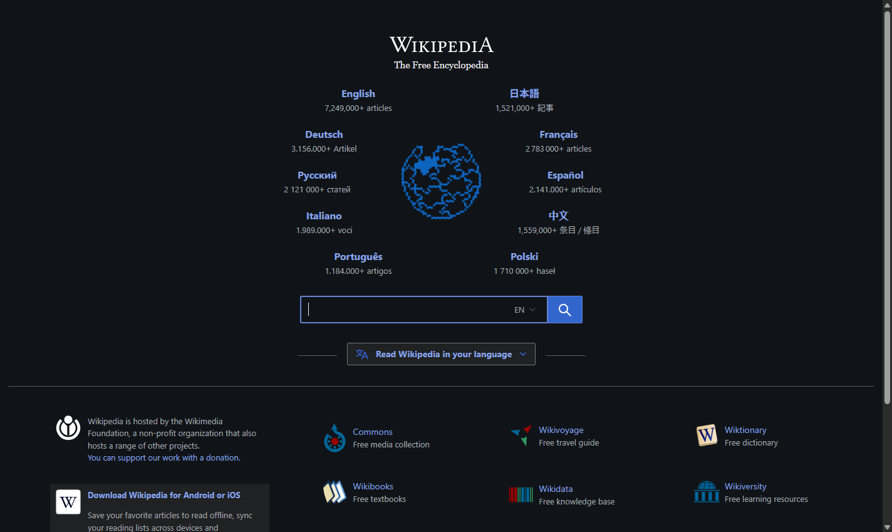

# No-BS Image Swapper

A userscript that replaces website images by resource URL or CSS selector. Rules can use hosted images or images stored by your userscript manager, and they persist across browser sessions.

## Install and update

Install [No-BS-Image-Swapper.user.js](https://raw.githubusercontent.com/VulpesNexus/no-bs-image-swapper/main/No-BS-Image-Swapper.user.js) from this public repository in a userscript manager that supports synchronous `GM_*` storage APIs, such as Tampermonkey or Violentmonkey, then reload the pages where it should run. Greasemonkey 4+ is not currently supported.

The script's update and download URLs point to the public repository's `main` branch. Automatic updates require your userscript manager to reach those URLs and a higher `@version` in a published script. Otherwise, update the installed copy manually.

The script runs on HTTP and HTTPS pages.

## Get started

Open *Manage image replacements* from the userscript manager menu. Select *Add manual rule* or *Pick from page*, choose the website and replacement image, and save. Rules can match an image URL or a CSS selector. The editor's *Page preview* shows the draft on the current page before you save it.

Use *NBSIS enabled* in the panel to change the running script immediately. A userscript manager's enable switch takes effect when the page reloads.

## Example: Wikipedia homepage

This example replaces the globe on the signed-out [Wikipedia homepage](https://www.wikipedia.org/) with the [Wikipedia 25 blue globe](https://commons.wikimedia.org/wiki/File:WP25_Wikipedia_Globe_-_blue.png). The replacement image is credited to Wikimedia Foundation staff and contractors under [CC BY 4.0](https://creativecommons.org/licenses/by/4.0/). The rule matches `.central-featured-logo` on `www.wikipedia.org` and fits the whole image in the original logo box.

| Before | Rule editor |
| --- | --- |
|  |  |

| Saved rule | After |
| --- | --- |
|  |  |

These screenshots came from a disposable test browser with simulated userscript manager storage. They show the page and rule UI; no rule was saved in an installed browser for this example. A separate [installed Tampermonkey check](tests/TAMPERMONKEY.md) covers installation, the manager menu, theme controls, and floating-button persistence.

## Limits and privacy

Uploaded images stay in userscript manager storage, but pages can inspect images displayed on them. Avoid confidential images on untrusted sites. Website content security policies may block replacements; canvas content and cross-origin iframes are unsupported. See [limits and privacy](docs/LIMITATIONS.md) for the full behavior and edge cases.

## More information

- [Usage guide](docs/USAGE.md)
- [Limits and privacy](docs/LIMITATIONS.md)
- [Development and checks](docs/DEVELOPMENT.md)
- [Related tools and credits](docs/RELATED-TOOLS.md)
